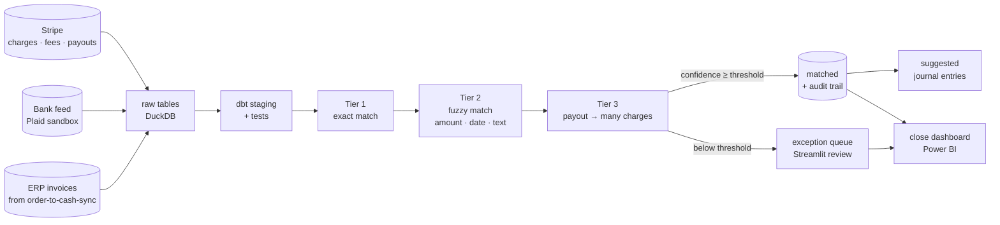

# Cash Reconciliation Engine

> **Automates the month-end match between payment processor payouts, bank deposits and ERP invoices, and routes only true exceptions to a human.**

🚧 *In progress. Planned architecture below.*

## The business problem

A Stripe payout that lands in the bank is not one payment. It is the net of dozens of charges, minus processing fees, minus refunds and disputes. To close the month, Accounting has to prove that every invoice was paid, every deposit is explained and every fee is booked. In most companies this happens in Excel, with VLOOKUPs and a lot of scrolling, and takes days.

## Planned workflow



## Planned stack

Stripe API (test mode) · Plaid Sandbox · DuckDB · dbt Core · pandas/polars · rapidfuzz · Streamlit · Power BI

## Layout

```
src/recon/      extractors, matching engine, journal-entry suggestions
dbt/            staging + marts, reconciliation tests
config/         matching tolerances and thresholds
tests/
```

Part of the *Northwind Outfitters* back-office portfolio, downstream of [order-to-cash-sync](https://github.com/janpaulreckling/order-to-cash-sync).
