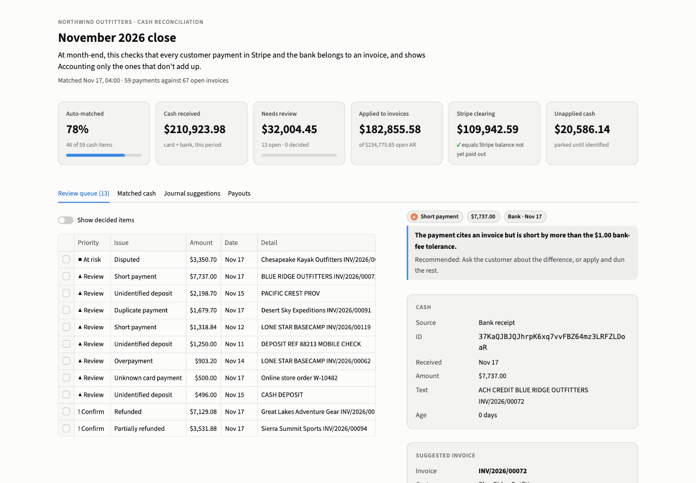
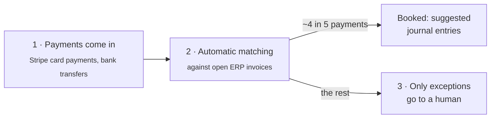
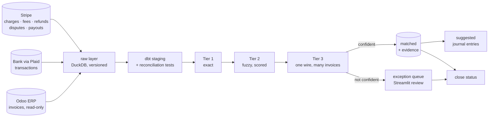

# Cash Reconciliation Engine

> **At month-end, this automatically checks that every customer payment in Stripe and the bank belongs to an invoice, and shows Accounting only the few that don't add up.**

[](https://github.com/janpaulreckling/cash-reconciliation-engine/actions/workflows/ci.yml)


[](https://northwind-cash-recon.streamlit.app)

**[Open the live demo](https://northwind-cash-recon.streamlit.app)**: the review app running on a snapshot of the real run, no login.





## Why it matters

A Stripe payout that lands in the bank is not one payment. It's the net of dozens of card payments, minus fees, minus refunds and disputes. Customers who pay by wire type the invoice number however they like, or not at all. To close the month, Accounting has to prove that every invoice was paid, every deposit is explained and every fee is booked. In most companies that means Excel, VLOOKUPs and a lot of scrolling.

| Without it | With it |
|---|---|
| Every payment matched by hand (~2–3 min each) | ~4 in 5 payments matched automatically, with the evidence attached |
| Fees, refunds and disputes reconstructed from Stripe exports | Suggested journal entries for every fee, refund, dispute and short-payment |
| "Does the Stripe clearing account tie out?" answered at the end | Checked on every run, to the cent |
| Problems found when the customer calls | A prioritized queue: money at risk first, each item with a recommended action |

*At 1,500 payments a month, a typical mid-market volume, automating 78% saves about 40–60 hours per close (assuming 2–3 minutes per manual match). That's an estimate from those stated assumptions, not a measurement.*

## At a glance

All numbers come from a real run against real sandbox APIs (Odoo ERP, Stripe test mode, Plaid Sandbox) for the November 2026 close of the fictional *Northwind Outfitters*.

| | |
|---|---|
| Payments processed | **59** (33 card, 26 bank), **$210,923.98** |
| Matched automatically | **46 (78%)**, none to the wrong cash |
| Sent to review | **13**, each with a reason code and recommended action |
| Stripe clearing vs. Stripe balance | **ties to the cent** ($109,942.59) |
| Designed scenarios (written with the engine) | **42 / 42** invoices as specified · **0** wrong automatic matches in 37 cash-invoice pairs |
| **Holdout** (new patterns, expectations fixed first) | **17 / 20** as specified · **0** wrong automatic matches in 16 pairs · recall 93% |
| Automated checks | 77 unit tests · 50 dbt build steps (models, unit + data tests) · both scenario sets gated in CI |

> **About those numbers.** The 42 designed scenarios were written together with the engine, so they prove the mechanics, not generalization. The [holdout](#holdout-unseen-patterns) uses new invoices and payment patterns whose expected outcomes were committed before the engine ran on them. Its misses are reported as they came out.

## Try it in one command

No accounts or keys needed. The demo rebuilds everything from a committed snapshot of the real run.

```bash
git clone https://github.com/janpaulreckling/cash-reconciliation-engine && cd cash-reconciliation-engine
uv sync --group dbt --group app
uv run recon demo                                  # snapshot -> dbt -> matching
RECON_DUCKDB_PATH=demo.duckdb make app             # open the review app
```

## How it works



| Tier | Rule | Example |
|---|---|---|
| **1 · Exact** | invoice reference (normalized) + amount to the cent | `inv 2026 82` = `INV/2026/00082` |
| **2 · Fuzzy** | weighted score: amount within tolerance (50%), reference or customer name (35%), date (15%); auto-applied at ≥ 0.90 with a clear margin over the runner-up | `ACH CREDIT DESERT SKY EXPEDITIONS`, no invoice number, exact amount |
| **3 · One-to-many** | one transfer = a unique subset of one customer's open invoices | one $15,161.32 wire paying three invoices |

What reaches a human, and why:

| Code | Meaning |
|---|---|
| `DISPUTED` · `PAYOUT_SUM_BREAK` · `PAYOUT_NOT_IN_BANK` | money at risk |
| `AMOUNT_MISMATCH` · `OVERPAYMENT` · `DUPLICATE_PAYMENT` · `UNAPPLIED_CASH` · `NO_CANDIDATE` · `AMBIGUOUS` | can't be applied safely |
| `PARTIAL_PAYMENT` · `REFUNDED` · `PARTIAL_REFUND` · `LOW_CONFIDENCE` | matched, needs a confirmation |

## Results

<details>
<summary><b>November run, per scenario (designed cases)</b></summary>

| Scenario | Count | Expected | Engine |
|---|---|---|---|
| Card payment with invoice reference | 18 | tier 1 | ✓ |
| Card payment without metadata, sloppy description | 2 | tier 2 | ✓ |
| Card: partial payment / refunded / partially refunded / disputed / paid twice | 5 | matched + exception | ✓ |
| Bank transfer with invoice number | 4 | tier 1 | ✓ |
| Bank transfer: reformatted number / dropped digit | 2 | tier 1 / tier 2 | ✓ |
| Bank transfer: customer name only | 1 | tier 2 | ✓ |
| Bank transfer: $0.75 bank fee deducted | 1 | tier 2 + write-off | ✓ |
| Bank transfer: $25 short / $50 over | 2 | exception | ✓ |
| One wire for three invoices | 1 (3 invoices) | tier 3 | ✓ |
| Unidentified deposits | 2 | `UNAPPLIED_CASH` | ✓ |
| Invoices left unpaid | 4 | stay open | ✓ |

Scored as **cash-invoice pairs**: linking the right invoice to another customer's money counts as an error.
</details>

### Holdout: unseen patterns

25 new real invoices, paid through Stripe and the bank with patterns the engine was never tuned on. The expected outcome of each case was written down from an AR clerk's point of view and committed ([`seeds/holdout`](seeds/holdout)) before the first matching run on them.

| Pattern | Expected | Engine | |
|---|---|---|---|
| Transposed digits in the reference (×2) | match (fuzzy) | match (fuzzy) | ✓ |
| Customer's PO number instead of our invoice number | match (fuzzy) | match (fuzzy) | ✓ |
| Paid a day before the invoice date | match (exact) | match (exact) | ✓ |
| Parent company pays for a subsidiary | match (exact) | match (exact) | ✓ |
| Card payment with only the billing name (×2) | match (fuzzy) | match (fuzzy) | ✓ |
| $0.40 bank fee short / $50 short | match + write-off / exception | same | ✓ |
| One transfer for two invoices, no references | human review | `LOW_CONFIDENCE` | ✓ |
| Exact references, card and bank (×6) | match (exact) | match (exact) | ✓ |
| Two open invoices of the same amount, no reference | human review | matched by date fit | ✗ |
| Cites a *different* open invoice of the same customer | human review | matched by amount and name | ✗ |
| Abbreviated payer name (`PACIFIC CREST PROV`), no reference | match (fuzzy) | `UNAPPLIED_CASH` | ✗ |

**What the misses mean:** no cash was applied to the wrong invoice (0 wrong automatic matches). Two cases were applied automatically where a clerk would have looked first. Both went to the right invoice, but one of them ignored a conflicting reference, which is a real risk. That's the next rule to add: when the memo cites a different open invoice of the same customer, send it to review. One case was missed, and it went to review instead of being booked. Fixing these now would leave the holdout unable to measure the fix, so it needs a fresh holdout first.

## Design decisions

<details>
<summary><b>Real APIs, no hand-made CSVs</b></summary>

Every record comes from a real system: invoices from Odoo 17 (fed from Salesforce by the sibling project), card payments from Stripe test mode, bank lines from the Plaid Sandbox. Seed scripts *create* the messy cases in those systems and record the expected outcome next to them, which turns matching quality into a measurable number. A committed snapshot of one run lets CI and the demo work without keys.

Things the real APIs taught along the way: Stripe test mode can't backdate charges, so the close period is the current month. A Stripe sandbox refuses test bank accounts on the platform itself, so Northwind is a Connect test merchant. Plaid accepts transactions posted right after an Item is created (200 OK) and silently drops them.
</details>

<details>
<summary><b>Never guess, never write to the ERP</b></summary>

- Applying cash is a decision with consequences. When two invoices fit equally well, the engine refuses to choose (`AMBIGUOUS`) instead of picking one.
- The engine only reads Odoo. Accepting a match in the review app writes an audit record (who, when, why, which run), not an ERP payment.
- Thresholds, tolerances and weights live in [`config/matching.yaml`](config/matching.yaml) and are reviewed like code.
</details>

<details>
<summary><b>Controls a controller would ask for</b></summary>

- **Payout sum:** every automatic Stripe payout equals the charges, fees, refunds and adjustments Stripe swept into it, to the cent (dbt test).
- **Clearing ties out:** suggested entries keep Stripe Clearing equal to the balance Stripe actually holds.
- **Double entry:** every suggested journal entry balances (dbt test).
- **No over-application:** no invoice receives more than was open on it (dbt test).
- **History, not overwrite:** raw tables keep every version of every record, so a cancelled invoice can't come back as posted and an auditor sees what each system said when.
</details>

<details>
<summary><b>Stack</b></summary>

Python 3.12 · DuckDB · dbt Core (dbt-duckdb) · rapidfuzz · Streamlit · Stripe API · Plaid API · Odoo XML-RPC · uv · ruff · mypy (strict) · pytest · GitHub Actions
</details>

## Project layout

```
src/recon/
  sources/        Odoo, Stripe, Plaid extractors -> versioned raw tables
  matching/       tiers, scoring, payouts, decision store
  seed/           scenario plans + sandbox seeding, ground truth
  app/            Streamlit review app
  evaluate.py     scoring against ground truth (cash-invoice pairs)
dbt/              staging, intermediate, marts, reconciliation tests
config/           matching thresholds
seeds/            scenario plans, ground truth, snapshot of the real run
docs/             data model and design notes
```

Full data model and matching design: [docs/data_model.md](docs/data_model.md).

## Related

Part of a back-office portfolio for the fictional outdoor retailer *Northwind Outfitters*. Invoices come from [order-to-cash-sync](https://github.com/janpaulreckling/order-to-cash-sync), which turns closed Salesforce deals into ERP orders and invoices.

## License

MIT
