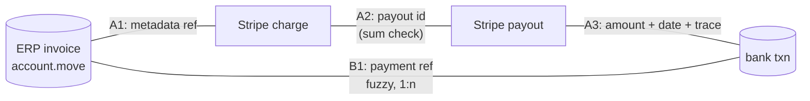

# Data model and matching design

Status: **agreed with user** (2026-11-17). Built so far: Odoo and Stripe extractors → raw layer.

**Close period: November 2026.** Stripe test mode cannot backdate charges or payouts, so the cash side is created live by the seed scripts in the current month; invoices issued before it are the open AR going into the close. That mirrors real cash application: money arrives first, the ERP is updated after reconciliation.

## 1. What has to reconcile

Northwind Outfitters gets paid two ways, and each has its own reconciliation path:

| Path | Money flow | What has to be proven |
|---|---|---|
| **A · Card payments** | Customer pays invoice by card → Stripe charge → Stripe batches charges into a **payout** (net of fees and refunds) → one bank deposit | (A1) every charge belongs to an invoice, (A2) every payout equals its charges − fees − refunds, (A3) every payout arrived in the bank |
| **B · Direct transfers** | Customer pays by ACH/wire straight to the bank, typing (or mistyping) the invoice number | (B1) every deposit is applied to one or more invoices, or flagged as unapplied cash |

Anything in the bank that is neither a Stripe payout nor a customer payment (rent, payroll, bank fees) is out of scope and is filtered by a category rule in staging.



## 2. Key chain (the data contract)

The whole design depends on which identifier links which system. Proposed:

| Link | Key | Who sets it |
|---|---|---|
| Salesforce Opportunity → ERP order | `sale.order.client_order_ref` = Opportunity Id | order-to-cash-sync (exists) |
| ERP order → ERP invoice | `account.move.invoice_origin` = `sale.order.name`, **comma-separated when one invoice covers several orders** (`S00012, S00013`), so it's n:m and staging splits it into a bridge table `int_erp__invoice_orders` | Odoo (standard) |
| ERP invoice → Opportunity | `account.move.ref`: Odoo copies `sale.order.client_order_ref` into it when it creates the invoice. Blank or concatenated for combined invoices, so the authoritative path is the bridge table above. *Verified 2026-11-17 against live Odoo 17: `ref` = 18-char Opportunity Id, `account.move` has no `client_order_ref` field, `payment_reference` = invoice name.* | Odoo (standard) |
| ERP invoice → Stripe charge | `PaymentIntent.metadata.erp_invoice_number` = `account.move.name` (e.g. `INV/2026/00012`); also `metadata.sf_opportunity_id` | payment link / checkout (simulated by our seed script) |
| ERP invoice → direct transfer | bank memo contains `account.move.payment_reference` (Odoo defaults it to the invoice number) | the customer, by hand, so expect typos |
| Stripe charge → payout | `balance_transaction.payout` (Stripe API, exact) | Stripe |
| Stripe payout → bank deposit | amount (exact), arrival date ±2 business days, `STRIPE` descriptor + payout `trace_id` when present | Stripe / bank |

This repo only **reads** Odoo. It never writes invoices or payments back. Applying cash in the ERP stays a human decision, and the engine produces suggested entries for it.

## 3. Raw layer (DuckDB, schema `raw`)

One table per source object, loaded as-is plus `_loaded_at` and `_source_run_id`. The real API extractors and the synthetic generator write **identical schemas**, so everything downstream doesn't care which one ran.

| Table | Grain | Key columns |
|---|---|---|
| `raw.erp_invoices` | one version of a customer invoice / credit note, **any state** (draft, posted, cancel) | `id`, `name`, `move_type` (`out_invoice`/`out_refund`), `state`, `partner_id`, `partner_name`, `invoice_origin` (may list several orders), `ref` (= `client_order_ref` copied from the order), `payment_reference`, `invoice_date`, `invoice_date_due`, `currency`, `amount_total`, `amount_residual`, `payment_state`, `write_date` |
| `raw.stripe_charges` | one charge | `id`, `payment_intent`, `amount`, `amount_refunded`, `currency`, `created`, `status`, `customer_email`, `description`, `metadata` (JSON), `balance_transaction` |
| `raw.stripe_balance_transactions` | one ledger movement (charge, refund, fee adjustment, dispute, payout) | `id`, `type`, `source`, `amount`, `fee`, `net`, `currency`, `created`, `available_on`, `payout` |
| `raw.stripe_refunds` / `raw.stripe_disputes` | one refund / dispute (links `re_`/`dp_` balance transactions back to the charge) | `id`, `charge`, `payment_intent`, `amount`, `created`, `status`, `reason` |
| `raw.stripe_payouts` | one payout | `id`, `amount`, `currency`, `arrival_date`, `status`, `trace_id`, `statement_descriptor` |
| `raw.bank_transactions` | one bank line (Plaid shape) | `transaction_id`, `account_id`, `date`, `amount`, `iso_currency_code`, `name`, `merchant_name`, `payment_channel`, `pending` |

Conventions:
- **Money as integer cents** (`BIGINT`) everywhere after staging. Stripe already uses minor units; ERP and bank decimals get converted once in staging. No floats.
- **USD only.** Same rule as order-to-cash-sync: no silent currency conversion. Other currencies fail a dbt test.
- **Sign convention:** cash in = positive. Plaid reports inflows as negative, so staging flips the sign.

## 4. dbt models

```
staging/   stg_erp__invoices (latest version per id FIRST, then keep state = posted; never 'latest posted version', which would resurrect cancelled invoices), stg_stripe__charges, stg_stripe__balance_transactions,
           stg_stripe__payouts, stg_bank__transactions   (typed, cents, sign-normalized, deduped)
intermediate/
           int_bank__classified          (stripe_payout | customer_payment | other)
           int_stripe__payout_components (payout → its balance transactions)
marts/     fct_matches                   one row per link, with tier, score, rule, run_id
           fct_exceptions                everything unmatched or below threshold, with reason code
           fct_journal_suggestions       proposed entries (see §6)
           rpt_close_status              per period: matched %, open exceptions, unexplained $
```

**Close dashboard:** Power BI Service in the browser (app.powerbi.com, free account; Power BI Desktop doesn't run on macOS), fed by file exports of the marts (`recon export`).

The matching itself runs in Python (`src/recon/matching`), because fuzzy scoring and the 1:n search don't fit SQL well. It reads staging views from DuckDB and writes `recon.match_candidates` / `recon.match_decisions`, which dbt then picks up for the marts.

**Reconciliation tests (dbt) are part of the deliverable:**
- `payout_sums_to_components`: for every payout, Σ(balance txn net) = payout amount, to the cent.
- `bank_stripe_deposits_explained`: every bank line classified `stripe_payout` matches exactly one payout.
- `no_double_application`: Σ cash applied to an invoice ≤ its `amount_total`.
- `match_is_exclusive`: one source record is in at most one accepted match per side (1:n is allowed only where it is declared).
- `period_tieout`: opening AR + invoiced − cash applied − credit notes = closing AR (cross-checked against Odoo `amount_residual`).

## 5. Matching engine

Each matcher emits **candidates** with a confidence in [0, 1]. A decision step accepts the best non-conflicting candidates at or above the threshold (`config/matching.yaml`, default 0.90) and sends the rest to the exception queue. Every decision stores the inputs, rule and score so an auditor can replay it.

| Tier | Applies to | Rule | Confidence |
|---|---|---|---|
| **1 · Exact** | A1, A3, B1 | reference equal after normalization (`INV/2026/00012` = `inv-2026-12`) **and** amount equal to the cent | 1.00 |
| **2 · Fuzzy** | A1, A3, B1 | amount within tolerance ($0.00 for Stripe; at most $1.00 absolute for transfers, no percentage component, so small bank-fee short-pays match and anything larger goes to the exception queue), date within ±3 days of due date / arrival, `rapidfuzz` token score on memo vs. invoice number + customer name | weighted: amount 0.5, reference/text 0.35, date 0.15 |
| **3 · One-to-many** | B1 (one transfer pays several invoices), A2 | B1: same customer, subset of open invoices summing to the transfer (bounded search: ≤ 6 invoices, open within 90 days). A2: verification via Stripe's payout id, not a search | B1: 0.85 if unique subset, lower if several subsets fit. A2: 1.00 or exception |

An honest point for the README: Stripe already tells us which charges went into a payout, so A2 is a **control** (does the arithmetic hold?), not a guessing game. The real one-to-many problem is customers who pay several invoices with one wire. That's where tier 3 earns its keep.

**Exception reason codes:** card side, matched but needs a human: `PARTIAL_PAYMENT`, `REFUNDED`, `PARTIAL_REFUND`, `DISPUTED`, `DUPLICATE_PAYMENT`. Payouts: `PAYOUT_NO_COMPONENTS` (manual payout: Stripe lists components only for automatic payouts), `PAYOUT_SUM_BREAK`, `PAYOUT_NOT_IN_BANK`, `DEPOSIT_WITHOUT_PAYOUT`. Unplaced cash: `NO_CANDIDATE`, `LOW_CONFIDENCE`, `AMBIGUOUS` (several candidates within 0.05), `AMOUNT_MISMATCH`, `OVERPAYMENT`, `PAYOUT_SUM_BREAK`, `DUPLICATE_PAYMENT`, `UNAPPLIED_CASH`.

## 6. Suggested journal entries

Generated, never posted. Each row: date, debit account, credit account, amount, memo, link to the match ids.

| Event | Dr | Cr |
|---|---|---|
| Card payment applied | Stripe clearing | Accounts receivable |
| Stripe fee | Merchant fees expense | Stripe clearing |
| Refund | Sales returns / AR | Stripe clearing |
| Payout lands in bank | Bank | Stripe clearing |
| Direct transfer applied | Bank | Accounts receivable |
| Short-pay within tolerance | Bank charges / write-off | Accounts receivable |
| Unidentified deposit | Bank | Unapplied cash (suspense) |

Stripe clearing must net to zero per closed payout. That's another dbt test, and it's the line a controller looks at first.

## 7. Demo data through the real APIs

Decision (2026-11-17): every record comes from a real API, no hand-made CSVs. A scenario seed script (`scripts/seed_scenarios.py`) *creates* the dirty cases in the real systems and writes the expected outcome next to them:

- **ERP:** invoices come from Odoo, fed by order-to-cash-sync from a real Salesforce org. Volume (target ~100+ invoices in one month, some with Net-30 terms) is coordinated with that project's seed script. This repo stays read-only on Odoo.
- **Stripe merchant:** the Stripe sandbox refuses test bank accounts on the platform itself, so Northwind is a **connected test account** created by `scripts/setup_stripe_merchant.py` (Accounts v2, Stripe test identity values, test bank 110000000/000123456789, automatic daily payouts). All Stripe calls carry `Stripe-Account: acct_...`. The platform collects fees, so the seed charges Stripe's standard 2.9% + 30¢ as an application fee, which is the `fee` on the merchant's balance transactions.
- **Stripe test mode:** for ~70 % of open invoices, a PaymentIntent with `metadata.erp_invoice_number` paid with test cards (`pm_card_bypassPending` so funds are available immediately), plus refunds, a dispute (`pm_card_createDispute`) and manual payouts in several batches.
- **Plaid Sandbox:** an Item on the `user_transactions_dynamic` test user. That user comes with 7 accounts and ~300 generated lines (loans, card, food); Northwind's operating account is the checking account (mask 1000), and staging keeps only that one. `/sandbox/transactions/create` posts the bank lines: one deposit per Stripe payout (some 1–3 business days late), direct ACH/wire payments with typo'd or missing references, one wire paying several invoices, a duplicate payment, and unrelated lines (payroll, rent, bank fee).
- **Ground truth:** the seed script writes `seeds/expected_matches.csv` (source ids + expected outcome per case). That turns matching quality into a number (precision/recall per tier) for the README and CI.

CI can't reach the sandboxes, so unit tests run against recorded API responses (fixtures captured from the real APIs, never invented). Matching and dbt tests run on a committed snapshot of one seeded run (`seeds/snapshot/*.csv` for all raw tables plus `expected_matches.csv`), so CI stays green without secrets.

## 8. Presentation

**UI bar: high-end, not default Streamlit** (user request 2026-11-17). Built after matching works.
- Streamlit review app with a custom theme (`.streamlit/config.toml` + CSS). Header shows close status: matched %, unexplained $, Stripe clearing balance. Left side: the exception queue with reason-code chips and amounts. Right side: the evidence side by side (invoice vs. charge vs. bank line), the confidence breakdown per signal, and Accept/Reject buttons that write to the audit trail.
- Power BI close report with a designed theme JSON, not the defaults.

- Live demo: the Streamlit review app on Streamlit Community Cloud, running on the committed `seeds/snapshot` (no secrets, no live APIs).
- Demo GIF of the real UI in the README, plus a 2-minute Loom script for the user to record.
- GitHub handle: `janpaulreckling` (id 333522828). Commits use `333522828+janpaulreckling@users.noreply.github.com` (repo-local git config).
- Recorded API fixtures are scrubbed of `*_secret` fields and receipt URLs before commit.

## Decisions and open questions

Decided 2026-11-17: Odoo is read directly (read-only XML-RPC); this repo creates the Stripe charges, so project #1 keeps no Stripe dependency; fiscal period = calendar month, cutoff by bank `date`.

Still open: how many invoices order-to-cash-sync's seed can produce for one demo month.
